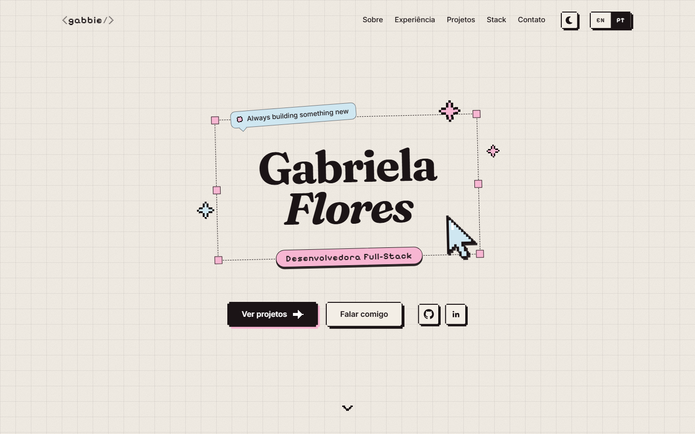
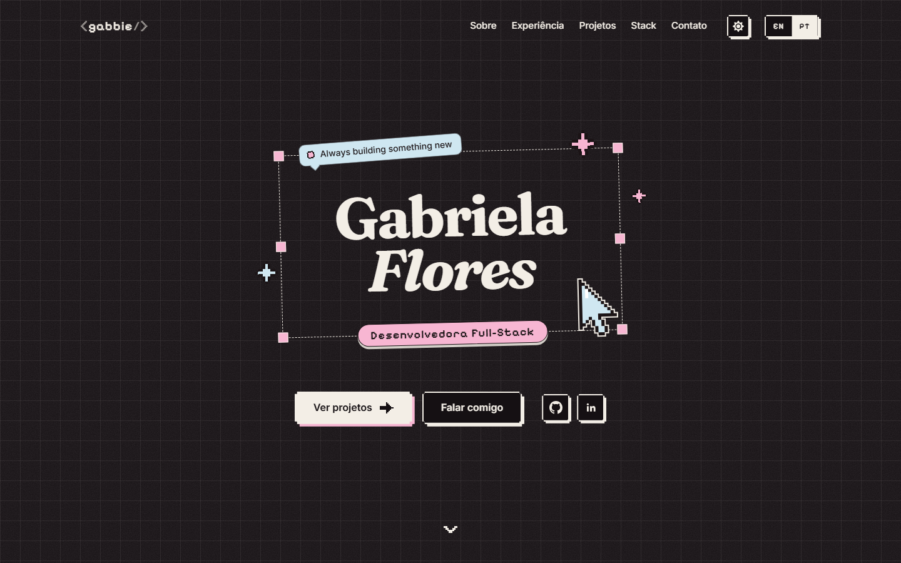

# Portfólio

Meu portfólio: projetos, experiência e tecnologias, em um site de uma página. 
_My portfolio: projects, experience and technologies, in a single page._

 

## Sobre o projeto

- **Bilíngue:** português e inglês, com a escolha guardada no navegador.
- **Tema claro e escuro:** troca instantânea, sem piscar no carregamento.
- **Sem biblioteca de UI:** os componentes e o sistema visual foram escritos do zero com Tailwind CSS.
- **Acessível:** HTML semântico, navegação por teclado, foco visível e respeito a `prefers-reduced-motion`.
- **Testado:** testes de ponta a ponta com Playwright.

## Contato

[LinkedIn](https://www.linkedin.com/in/gabriela-flores-lopes/) · [GitHub](https://github.com/gabbiefl)

## Créditos

Ícones das tecnologias: [Skill Icons](https://skillicons.dev). Ícones da interface: [Font Awesome Free](https://fontawesome.com) (CC BY 4.0). Fontes: Fraunces, Inter e Pixelify Sans, via [Fontsource](https://fontsource.org).
